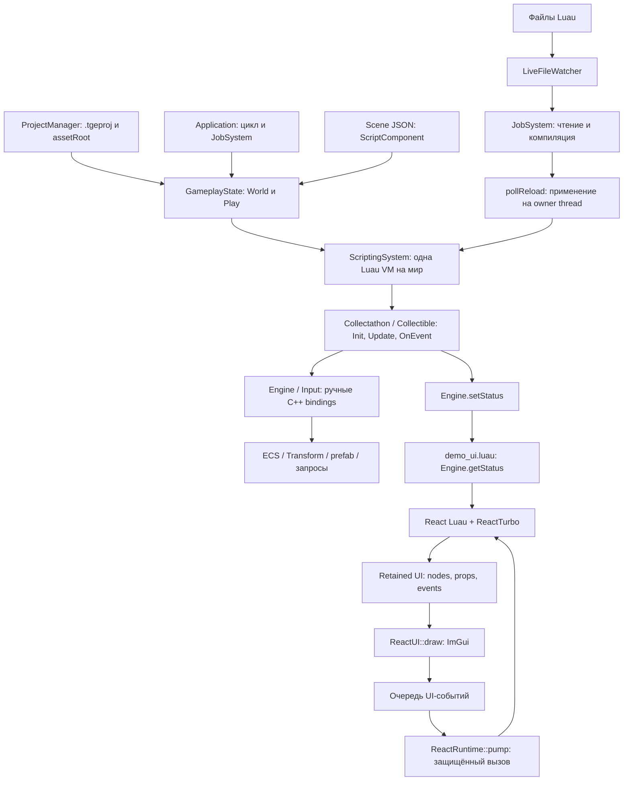

# ЛР 2: архитектура скриптовой подсистемы TurboGameEngine

Документ описывает текущее рабочее дерево, включая незакоммиченные изменения,
на 16 октября 2026 года. Это карта реализации для чтения кода и ответов на защите.
Сценарий выступления и результаты запусков находятся в [материалах защиты](defense/README.md).

## 1. Что именно решает ЛР 2

Цель — менять игровые правила без пересборки C++ и перезапуска движка.
Для этого в существующий C++20-движок встроены Luau VM, поведения сущностей,
двусторонние bindings, prefab-спавн, поля Inspector и hot reload.
Законченная механика — Collectathon: движение, подбор предметов, волны,
счёт, таймер, победа и перезапуск написаны на Luau.

Граница ответственности:

| Слой | Что делает | Где находится |
| --- | --- | --- |
| C++-движок | ECS, жизненный цикл VM, ввод, физика, ресурсы, рендер, редактор | `engine/` |
| Игровые скрипты | Правила и сессионное состояние Collectathon | `assets/scripts/Collectathon.luau`, `Collectible.luau` |
| Данные проекта | Сцена, компоненты, prefab и значения полей | `.tgeproj`, `assets/scenes/`, `assets/prefabs/` |
| Скриптовый UI | Компоненты HUD и обработчики UI | `assets/scripts/ui/demo_ui.luau` |
| React и native host | Reconciliation, hooks, retained-дерево и его отрисовка | `third_party/react-luau/`, `engine/scripting/react/` |

ECS, renderer и JobSystem служат основой ЛР 2. Игровые условия не перенесены
внутрь C++ bindings: например, именно `Collectathon:Update` решает, когда
предмет подобран и достигнута победа.

## 2. С чего начать чтение

1. [ScriptComponent.h](../../engine/scripting/ScriptComponent.h) — какие данные поведения принадлежат сцене.
2. [ScriptingSystem.h](../../engine/scripting/ScriptingSystem.h) — публичный интерфейс подсистемы и лимиты.
3. [ScriptingSystem.cpp](../../engine/scripting/ScriptingSystem.cpp) — VM, bindings, экземпляры, prefab и reload.
4. [GameplayState.cpp](../../engine/game/GameplayState.cpp) — кто вызывает подсистему и в каком порядке.
5. [Collectathon.luau](../../assets/scripts/Collectathon.luau) — вся основная механика.
6. [demo_ui.luau](../../assets/scripts/ui/demo_ui.luau) — как механика передаёт данные в React HUD.
7. [ReactRuntime.cpp](../../engine/scripting/react/ReactRuntime.cpp) и [ReactUI.cpp](../../engine/scripting/react/ReactUI.cpp) — как React подключён к VM и ImGui.
8. [ScriptingSystemTests.cpp](../../tests/ScriptingSystemTests.cpp) — проверяемые контракты и регрессии.

Искать в больших `.cpp` удобнее по именам функций из таблиц ниже: номера строк
меняются при правках.

## 3. Общая схема



`GameplayState` владеет `m_world` и `m_scripts`. `ScriptingSystem` хранит
не владеющую ссылку на World и владеет VM через свой `Impl`.
Отдельная VM на каждую сущность не создаётся.

## 4. Карта файлов и точек входа

### Запуск и интеграция

| Файл | Основные точки | Ответственность в ЛР 2 |
| --- | --- | --- |
| [app/main.cpp](../../app/main.cpp) | разбор `--play-session`, запуск Application | Обычный редактор и дочернее игровое приложение |
| [Application.cpp](../../engine/core/Application.cpp) | `init`, `run`, `shutdown` | Создание сервисов; ограниченный цикл fixed update; render/UI/present |
| [GameplayState.h](../../engine/game/GameplayState.h) | `m_world`, `m_scripts`, snapshot/history | Владение игровым миром и интеграцией редактора |
| [GameplayState.cpp](../../engine/game/GameplayState.cpp) | `onEnter`, `onExit`, `enterPlayMode`, `stopPlayMode` | Создание VM, установка React, запуск/остановка поведений, восстановление сцены |
| [ProjectManager.cpp](../../engine/core/ProjectManager.cpp) | загрузка проекта и разрешение путей | Собственный assetRoot и startupScene каждого проекта |
| [PlaySession.cpp](../../engine/core/PlaySession.cpp) | `start`, `stop`, `load` | Дочерний процесс, временный снимок сцены и manifest |

### Скриптовая подсистема

| Файл / часть | Основные точки | Что хранит или выполняет |
| --- | --- | --- |
| [ScriptComponent.h](../../engine/scripting/ScriptComponent.h) | `path`, `enabled`, `fields` | Только сериализуемые данные; никаких `lua_State*` и Lua registry refs |
| [ScriptingSystem.h](../../engine/scripting/ScriptingSystem.h) | `initialize/start/update/stop/shutdown`, reload, inspection | Контракт подсистемы; `ScriptMessage`, `ScriptField`, `Limits` |
| [ScriptingSystem.cpp](../../engine/scripting/ScriptingSystem.cpp), `Impl` | `Module`, `Instance`, `loadModule`, `instance`, `callback` | VM, registry refs модулей/экземпляров, граф `require`, вызовы методов |
| Там же | `installBindings`, `bind`, диспетчер `Api` | Таблицы `Engine`, `Input`, собственные `require` и `print` |
| Там же | `fieldDefinitions`, `defaults`, `syncFields` | Проверка схемы, значения по умолчанию, перенос Inspector-полей в `self.fields` |
| Там же | `spawnPrefab`, `flushDestroy`, `forgetEntity` | Создание компонентов и безопасное завершение времени жизни сущностей |
| Там же | `requestReload`, `pollReload` | Подготовка bytecode, обновление модулей и методов без сброса `self.state` |
| [LiveFileWatcher.cpp](../../engine/core/LiveFileWatcher.cpp) | `watch`, `poll`, `clear` | Чтение в jobs, сравнение содержимого, debounce по повторному наблюдению |
| [JobSystem.cpp](../../engine/core/JobSystem.cpp) | `dispatch`, `isComplete`, `wait` | Фоновое чтение/компиляция; не исполнение Luau VM |

### UI и редактор

| Файл | Ответственность |
| --- | --- |
| [ReactRuntime.cpp](../../engine/scripting/react/ReactRuntime.cpp) | Установка upstream-пакетов и адаптеров; `install`, `pump`, `reset` |
| [ReactTurbo.luau](../../third_party/react-luau/adapters/ReactTurbo.luau) | Host config reconciler, roots/portals, props, refs/bindings, события и очистка |
| [RobloxUI.luau](../../third_party/react-luau/adapters/RobloxUI.luau) | Явная UI-модель `Instance`, типы значений, свойства, parenting и сигналы |
| [TweenService.luau](../../third_party/react-luau/adapters/TweenService.luau) | UI-анимации, easing, владение goals и единый pump |
| [ReactUI.cpp](../../engine/scripting/react/ReactUI.cpp) | Layout, clipping, drawing, hit testing, native geometry и очередь UI-событий |
| [UiCanvasCompositor.cpp](../../engine/renderer/UiCanvasCompositor.cpp) | GPU-композиция CanvasGroup с удержанием ресурсов до fence |
| [ScriptWorkspace.cpp](../../engine/editor/ScriptWorkspace.cpp) | Документы, Save/Reload, Output, Command, Watch/State, Errors, конфликт диска и буфера |
| [ScriptFormatter.cpp](../../engine/editor/ScriptFormatter.cpp) | Асинхронный запуск StyLua и возврат результата |
| [TextEditor.cpp](../../third_party/ImGuiColorTextEdit/TextEditor.cpp) | Редактирование текста, подсветка Luau, собственный Undo/Redo документа |
| [EditorCommands.cpp](../../engine/editor/EditorCommands.cpp), [GameplayCommands.cpp](../../engine/game/GameplayCommands.cpp) | Общий query/dispatch команд; вызов существующих обработчиков GameplayState/ScriptWorkspace |
| [EditorRibbon.cpp](../../engine/editor/EditorRibbon.cpp) | Представление команд на Home/Model/Test/View/Script |
| [AtomicFile.cpp](../../engine/core/AtomicFile.cpp) | Атомарное сохранение файлов редактора |

## 5. Жизненный цикл: от запуска до выхода

### Создание VM

`GameplayState::onEnter` загружает сцену проекта, затем вызывает
`m_scripts.initialize(m_world, jobs, editorAssetsRoot())`. В `initialize`:

1. Проверяется owner thread, зафиксированный при создании `ScriptingSystem::Impl`;
   запоминаются World, JobSystem и нормализованный assetRoot.
2. `lua_newstate` создаёт VM с собственным allocator, считающим занятую память.
3. Устанавливаются interrupt/watchdog, библиотеки, bindings, sandbox.

После возврата из `initialize` сам `GameplayState::onEnter` вызывает
`ReactRuntime::install`, подключая React и UI-адаптеры в эту же VM,
и инициализирует ScriptWorkspace с доступом к подсистеме и действиям Play/Stop/Step.

VM существует и в Edit: она нужна для загрузки описаний полей, проверки кода
и консоли. `Play` создаёт экземпляры поведений, а не новую VM целиком.

### Вход в Play

`GameplayState::enterPlayMode` завершает текущую правку, сохраняет снимок сцены
и Edit-историю Undo/Redo, переключает режим и вызывает `ScriptingSystem::start`.
`start` завершает прежние экземпляры, подхватывает актуальные файлы модулей,
сбрасывает status и создаёт экземпляры включённых `ScriptComponent`.

`Impl::instance` загружает таблицу поведения, создаёт `self`, сохраняет registry ref
и вызывает `Init`. Методы находятся через `__index` таблицы поведения.
При появлении новых script-компонентов `instantiateNew` подключает их на последующих тиках.

### Один тик и один render

`Application::run` вызывает обновление StateStack фиксированными шагами;
догоняющая работа ограничена, чтобы медленный кадр не порождал бесконечную очередь тиков.
В обновлении GameplayState порядок такой:

```text
ScriptWorkspace.update / pollSceneChanges / scripts.pollReload
    -> вычисление разрешения игрового ввода
    -> при Play и Running либо Step Tick:
         scripts.update(dt)
           -> подключение новых экземпляров, syncFields, Update, flushDestroy
         physicsSystem.update(...)
           -> события CollisionEnter / CollisionStay / CollisionExit
         scripts.dispatchEvents()
           -> OnEvent, затем flushDestroy
         ReactRuntime::pump(dt)
           -> UI callbacks, эффекты/служебная работа адаптера, tweens
    -> позднее, в активном ImGui frame: ReactUI::draw(...)
```

`Pause` прекращает игровые тики; `Step Tick` разрешает один шаг с `1/60` секунды.
Проверка дисковых изменений остаётся в обновлении редактора. UI callback,
обнаруженный при рисовании, выполняется через защищённый pump последующего тика,
а не напрямую из C++ обхода draw-дерева.

### Stop и закрытие

`stopPlayMode` сначала сбрасывает React roots/events, затем останавливает скрипты,
очищает ожидающие runtime-удаления и восстанавливает снимок и историю Edit.
`ScriptingSystem::stop` вызывает `Destroy`, освобождает refs экземпляров и очереди,
но оставляет саму VM и модульный cache для редактора.

`GameplayState::onExit` вызывает `ScriptingSystem::shutdown` до очистки World.
`shutdown` завершает watcher/jobs, очищает reload, останавливает поведения
и вызывает `lua_close`. После этого не остаётся валидных Lua refs этой VM.

## 6. Три разных вида данных поведения

| Данные | Владелец | Сохраняются в сцену | Что происходит при hot reload |
| --- | --- | --- | --- |
| `ScriptComponent.fields` | ECS/сцена, JSON | Да | Остаются источником авторских значений; применяются defaults/валидация |
| `self.fields` | Lua-экземпляр, копия параметров | Не напрямую | Синхронизируются из компонента |
| `self.state` | Lua-экземпляр | Нет | Сохраняется та же runtime-таблица при успешном обновлении методов |

`self.entity` — числовой EnTT handle с поколением. Доступ к C++ идёт через
проверяющие bindings; скрипт не получает владеющий указатель на компонент.
Проверяются существование сущности и факт ожидающего удаления.

Схема `Behavior.fields` поддерживает числа, целые числовые значения, boolean,
string, default и числовые min/max. `fieldDefinitions/defaults` проверяют схему
и значения; `GameplayState::renderScriptInspector` выбирает соответствующий виджет.
Сериализованные корректные значения имеют приоритет над defaults модуля.
Изменение default в коде не является принудительным изменением уже заданного поля сцены.

`self.state` содержит, например, score, player, remaining и wave. Его сохранение
при reload не означает save game и не обеспечивает автоматическую миграцию схемы.
Если меняется формат состояния, совместимость нужно обработать в `OnReload`.

## 7. Двусторонняя граница C++ / Luau

Из C++ в Luau вызываются `Init`, `Update(dt)`, `OnEvent(event)`, `Destroy`, `OnReload`.
Это таблица поведения с методами, а не наследование от C++ класса через trampoline.
`Impl::callback` и protected host entry защищают и сам вызов, и подготовку Lua-данных.
`print` направляется в `ScriptMessage`, ошибки получают traceback и видны редактору.

Из Luau в C++ используются ручные bindings в `Impl::installBindings`:

| Задача | API |
| --- | --- |
| Проверка/поиск | `Engine.isAlive(id)`, `getTag(id)`, `find(tag)` |
| Transform | `getPosition/setPosition`, `getRotation/setRotation` — вращение Euler в радианах |
| Ввод | `Input.isKeyDown`, `wasKeyPressed`, `wasKeyReleased`, `mousePosition` |
| Создание/удаление | `Engine.spawnPrefab(path, overrides?)`, `Engine.destroy(id)` |
| Пространственный запрос | `Engine.queryRadius(position, radius, tag?)` |
| Физика | `getVelocity/setVelocity`, `applyForce` |
| Обмен с HUD | `Engine.setStatus(name, value)`, `Engine.getStatus(name?)` |

Ввод разрешается для активного игрового viewport/standalone. Текстовый ввод
в редакторе кода или чате не должен превращаться в движение или scene shortcut.

Коллизии поступают из EventBus в `queueEvent`, затем `dispatchEvents` передаёт
их поведениям через `OnEvent`. Это ограниченная очередь с broadcast-доставкой,
не универсальная скриптовая шина с динамической подпиской и приоритетами.

### Кто и когда уничтожает сущность

`spawnPrefab` на owner thread читает/разбирает JSON, подготавливает компоненты
и создаёт ECS-сущность сразу; при ошибке добавления выполняется rollback.
`Engine.destroy` из поведения сначала помечает handle в `pendingDestroy`:
для bindings он уже считается неживым. Реальное удаление выполняет `flushDestroy`
на безопасной границе после callbacks.

`forgetEntity` освобождает экземпляр поведения, но **не отменяет pendingDestroy**.
Это существенный исправленный дефект: иначе поздний в порядке Update HUD мог
потерять Lua-экземпляр, остаться в ECS и повторно выполнить Init на следующем тике.
Проверка `updateDestructionKeepsPrefabRespawnsBounded` в
[ScriptingSystemTests.cpp](../../tests/ScriptingSystemTests.cpp) воспроизводит
серии уничтожений и повторного спавна с реальными prefab/HUD.

## 8. Prefab, сцена и Inspector

Prefab описывает исходные компоненты. Например,
[collectathon_controller.json](../../assets/prefabs/collectathon_controller.json)
содержит `script.path` и баланс механики. Минимальная форма:

```json
{
  "name": "Controller",
  "components": {
    "tag": "Controller",
    "transform": { "position": [0, 0, 8] },
    "script": {
      "path": "scripts/Collectathon.luau",
      "enabled": true,
      "fields": { "goal": 10, "duration": 45, "tokenCount": 12 }
    }
  }
}
```

`Engine.spawnPrefab` принимает путь относительно assetRoot. Overrides применяются
как JSON merge patch до разбора компонентов. Поддержаны Transform, Tag,
MeshRenderer, Rigidbody, Collider, ScriptComponent.

Сцена сериализуется отдельно в `GameplayState::serializeScene`, загружается
через `loadSceneFromDisk` и восстанавливается через `restoreSceneSnapshot`.
У scene v1 список `entities` и `sourceId`; у prefab — `components`.
В сцене Tag записан объектом `{ "value": "..." }`, в prefab допустима строка.
Ссылки Lua и `self.state` в JSON не попадают.

Правка Inspector изменяет компонент и входит в scene history.
В Play параметры могут действовать на текущий экземпляр после `syncFields`,
но Stop возвращает авторский снимок. Save Scene разрешён в Edit;
сохранение сцены не является сохранением всей игровой сессии.

## 9. Как устроен hot reload

Источники запроса: автоматический watcher, Inspector → Reload Module,
Script Workspace → Save + Reload и актуализация при следующем Play.

1. `require` загружает модуль в cache и записывает зависимость родитель → ребёнок.
   Пути нормализуются и проверяются относительно assetRoot.
2. `LiveFileWatcher` сравнивает содержимое; два одинаковых наблюдения новой версии
   защищают от промежуточного состояния во время сохранения файла.
3. `requestReload` расширяет batch потребителями изменённого модуля.
   Это нужно и для `local rule = require(...)`, где сохранена функция/скаляр.
4. Чтение и компиляция в bytecode выполняются JobSystem с Low priority.
   В headless-режиме без JobSystem предусмотрено синхронное выполнение.
5. `pollReload` на owner thread проверяет завершение, затем защищённо загружает
   подготовленные модули. Worker не исполняет Luau и не меняет ECS.
6. При ошибке компиляции/загрузки сохраняется предыдущий рабочий cache модулей;
   диагностика сообщает, что прежний код оставлен.
7. При успехе экземпляру меняют таблицу методов, сохраняют `self.state`,
   синхронизируют авторские fields и вызывают необязательный `OnReload`.
   `Init` повторно не вызывается.

Для React дополнительно сопоставляются старые/новые функции экспортов и вызывается
`__turboUIRefresh`. Это помогает обновить уже захваченные callbacks, но не обещает
сохранить все hooks при смене идентичности компонента или remount.
Ошибка внутри пользовательского `OnReload` диагностируется как ошибка callback;
hot reload не является транзакционным rollback произвольных игровых действий.

Live reload сцены — отдельный путь: `pollSceneChanges/applyLiveScene` в GameplayState
сопоставляют `sourceId` и применяют авторские изменения свойств, сохраняя текущие
симулируемые значения там, где файл их не менял. Это не замена всей сцены каждый кадр.

## 10. Collectathon: конкретный путь данных

| Файл | Что делает |
| --- | --- |
| [Collectathon.luau](../../assets/scripts/Collectathon.luau) | `Init → Restart`, `SpawnWave`, движение, proximity-подбор, score/timer/result, публикация status |
| [Collectible.luau](../../assets/scripts/Collectible.luau) | Запоминает исходную позицию в Init, анимирует предмет в Update |
| [collectathon_player.json](../../assets/prefabs/collectathon_player.json) | Шаблон игрока с Tag/Transform и отображением |
| [collectible.json](../../assets/prefabs/collectible.json) | Шаблон предмета с поведением Collectible |
| [collectathon_controller.json](../../assets/prefabs/collectathon_controller.json) | Баланс и подключение основного поведения |
| [react_ui.json](../../assets/prefabs/react_ui.json) | Отдельная сущность с HUD-поведением |
| [demo_ui.luau](../../assets/scripts/ui/demo_ui.luau) | Создаёт React root, читает status, рисует HUD и hooks-счётчик, unmount в Destroy |

Пример одного подбора:

```text
Input -> Collectathon.Update
  -> Engine.setPosition(player, ...)
  -> Engine.queryRadius(position, pickupRadius, "ScriptToken")
  -> Engine.destroy(token) + self.state.score += pointsPerToken
  -> проверка goal / remaining в Luau
  -> Engine.setStatus("score", ...) и остальные показатели
  -> demo_ui.Update -> root:render(HUD с Engine.getStatus())
  -> React reconciliation -> ReactUI.draw
```

Подбор выполняется пространственным запросом, а не callback коллизии.
`OnEvent(CollisionEnter)` отдельно считает события физики.
Состав экземпляров обновляется детерминированно по ID; новый status виден HUD
при его очередном Update, поэтому UI не должен зависеть от особого порядка сущностей.

Готовая отдельная сцена находится в
[demos/lab2-collectathon](../../demos/lab2-collectathon/README.md).
Её `.tgeproj` указывает собственный `assets` и startupScene; проект содержит копии
нужных scripts/prefabs. Править нужно файлы активного проекта, а не одноимённый
скрипт в другом assetRoot.

## 11. Как настоящий React работает в native движке

`ReactRuntime::install` читает vendored `manifest.tsv` и upstream-модули,
создаёт совместимую иерархию `script` для `require`, устанавливает compatibility,
RobloxUI и TweenService, затем регистрирует `ReactTurbo` и alias `ReactRoblox`.
Bootstrap прогревает hooks под отдельным доверенным бюджетом и возвращает
обычные лимиты пользовательских callbacks.

Hooks, effects, context, memo, refs, bindings и reconciliation — upstream React Luau.
`ReactTurbo` задаёт host config и использует синхронный `LegacyRoot`.
RobloxUI предоставляет поддержанные UI Instance/Enum/UDim/UDim2/Vector2/Color3;
это явный UI facade, а не полный Roblox DataModel.

При `root:render` reconciler меняет retained-узлы и props.
`ReactUI::draw` читает их в активном ImGui frame на owner thread, вычисляет layout,
рисует виджеты/изображения и ставит события в очередь. Чтение raw-полей не должно
выполнять произвольный пользовательский metatable из draw traversal.
Geometry вроде AbsoluteSize публикуется как read-only данные с отложенными signals.

Порядок `ReactTurbo.pump`: снимок и очистка очереди UI-событий → batched dispatch
обработчиков → compatibility task/Heartbeat pump → TweenService → passive effects.
Следующий pump не обязательно совпадает со следующим визуальным кадром:
фиксированных тиков между отрисовками может быть несколько.

`root:unmount` освобождает дерево, подписки/bindings и вызывает effect cleanup;
переданный вызывающим кодом Instance-контейнер остаётся у владельца.
Общая очередь событий при обычном unmount не очищается: события уничтоженных
узлов игнорируются при dispatch.
Глобальный `reset` шире: очищает tweens, размонтирует все roots, уничтожает UI Instance,
повторно очищает tweens, события и задачи игрового поколения. Внутренние задачи
upstream Scheduler сохраняются. Pause сохраняет дерево и draw, но останавливает pump.
TweenService использует общий ограниченный pump; binding и tween
не могут одновременно владеть одной целью. CanvasGroup захватывает поддерево
и композитит его как слой через GPU, включая вложенные группы.
UI images разрешаются через Renderer; GPU views удерживаются до завершения frame fence.

Подробные контракты и ограничения:
[совместимость UI](../roblox-ui-compatibility.md),
[layout и visuals](../roblox-ui-visuals.md),
[TweenService](../tween-service.md), [CanvasGroup](../canvas-groups.md).
Произвольные web DOM/CSS, Roblox services, сетевые/CDN images и полный
Roblox scheduler не предоставляются. Font использует доступные native шрифты приложения.

## 12. Редактор, команды и два режима Play

ScriptWorkspace хранит буфер документа отдельно от VM. До сохранения правка текста
не становится кодом игрового модуля. Save использует AtomicFile, проверяет внешние
изменения и конфликт; Save + Reload дополнительно вызывает `requestReload`.
StyLua работает асинхронно; результат применяется только к подходящему
неизменившемуся документу. Syntax Check проверяет компиляцию, а не выполняет
полный type checker, language server или пошаговый VM debugger.

Общий `EditorCommandRegistry` хранит определения и query/dispatch команд.
Лента, меню и shortcuts используют текущие enabled/checked состояния и существующие
обработчики; `GameplayCommands.cpp` связывает их со сценой и ScriptWorkspace.
Лента сама не содержит отдельную реализацию Play, Undo или Save.

Разделение истории принципиально:

- Scene Undo/Redo восстанавливает снимки ECS. В Play скриптовые экземпляры
  запускаются заново; это не перемотка VM и `self.state`.
- Undo/Redo текста принадлежит TextEditor и не заменяется scene history.
- Stop возвращает сцену и Edit-историю, захваченные перед Play.

Play Window через `launchStandalonePlay → PlaySession::start` создаёт отдельный
процесс того же `app.exe` с временным снимком и manifest. Оригинальная авторская
сцена остаётся источником live edits и отличается от стартового snapshot.
В child process есть игра и React UI без редакторских панелей.
Формат проекта и жизненный цикл описаны в [projects.md](../projects.md).

Опциональный [CodexAssistant.cpp](../../engine/editor/CodexAssistant.cpp) запускает
официальный локальный `codex app-server`. Он не исполняет Luau и не нужен для
запуска механики; редакторское AI-взаимодействие отделено от игровой VM.

## 13. Сборка, доставка и защита от ошибок

В [CMakeLists.txt](../../CMakeLists.txt) VM и Compiler Luau линкуются в
`engine_scripting` вместе с ScriptingSystem/ReactRuntime. Системная установка
интерпретатора для игрока не требуется. `engine_game` добавляет ReactUI и редактор;
поэтому базовые VM/React-тесты работают без окна. Post-build `app` копирует assets
и React-пакеты рядом с бинарником; пользовательские проекты имеют отдельные roots.

Основные защиты находятся в `ScriptingSystem::Impl`:

- Вся работа с VM и структурой World — на owner thread; jobs только готовят данные.
- VM allocator ограничивает память: по умолчанию 64 MiB; исходник — 2 MiB.
- Interrupt ограничивает пользовательский callback: 25 ms Release / 100 ms Debug.
  Доверенная установка React имеет отдельный временный бюджет.
- Ошибки методов/подготовки экземпляра перехватываются protected entry;
  ошибочное поведение получает диагностику вместо выхода исключения через host.
- Путь модуля/prefab проверяется относительно assetRoot; handles проверяются
  на liveness/generation; pending destroy отделён от освобождения Lua refs.
- Закрытие дожидается работ и освобождает refs/VM до удаления World.

Это контролируемая общая VM на мир. Отдельная изоляция по модам/сущностям,
автоматическая генерация bindings, Inspector-поля-ссылки, полноценный VM debugger
и сериализация `self.state` как save game здесь не реализованы.

## 14. Чем проверяется каждый контракт

| Файл / инструмент | Что проверяет |
| --- | --- |
| [ScriptingSystemTests.cpp](../../tests/ScriptingSystemTests.cpp) | Runtime/bindings/prefab/fields, состояние при reload, dependency reload, ошибки, hostile-таблицы, регрессия уничтожения/respawn |
| [ReactRuntimeTests.cpp](../../tests/ReactRuntimeTests.cpp) + [ReactRuntimeTests.luau](../../tests/ReactRuntimeTests.luau) | Настоящий React bootstrap, hooks/host contracts, очистка roots/events, баланс Lua stack, callback watchdog |
| [TweenServiceTests.luau](../../tests/TweenServiceTests.luau), [CanvasGroupTests.luau](../../tests/CanvasGroupTests.luau) | Tween/binding/lifetime и facade-контракты CanvasGroup |
| [GameplayStateTests.cpp](../../tests/GameplayStateTests.cpp) | Play/Stop, сцены/история, live scene, project isolation, native UI и standalone smoke |
| [CanvasGpuTests.cpp](../../tests/CanvasGpuTests.cpp) | Отдельная проверка GPU-compositor; не подменяется headless React-тестом |
| [ScriptEditorTests.cpp](../../tests/ScriptEditorTests.cpp), [ScriptFormatterTests.cpp](../../tests/ScriptFormatterTests.cpp) | Подсветка/редактирование сложных исходников и безопасное применение StyLua |
| [EditorCommandTests.cpp](../../tests/EditorCommandTests.cpp), [ScriptWorkspaceCommandTests.cpp](../../tests/ScriptWorkspaceCommandTests.cpp) | Query/dispatch и команды документов |
| [LiveFileWatcherTests.cpp](../../tests/LiveFileWatcherTests.cpp), [AtomicFileTests.cpp](../../tests/AtomicFileTests.cpp) | Наблюдение за содержимым и безопасная запись |
| [run_lab2_stability.py](../../tools/run_lab2_stability.py) | Windows Release-сессия на собственном fixture: reload/respawn, логи, process counters |
| [verify_lab2_memory](../../tools/verify_lab2_memory/README.md) | Headless ASan/LSan/UBSan и ограниченность сущностей/UI в повторных циклах |

Фактические результаты, версии бинарников и пределы выводов зафиксированы в
[verification.json](defense/verification.json) и [memory-report.md](defense/memory-report.md).
В итоговом прогоне: Windows CTest 19/19, Release-сессия около 300 секунд без
Luau/OOM ошибок, headless sanitizer-проверки и 240 lifecycle-циклов.
Windows process counters сами по себе не доказывают отсутствие утечек.
CLion Profile для выбранного Windows/MSVC toolchain оказался недоступен;
альтернативные sanitizer-прогоны не выдаются за профиль CLion или проверку всех GPU-путей.

## 15. Где менять конкретную функцию

| Нужно изменить | Начать с |
| --- | --- |
| Правило победы, таймер, подбор, волну | `Collectathon.luau`; параметры экземпляра — prefab/Inspector |
| Внешний вид и события игрового HUD | `scripts/ui/demo_ui.luau` активного проекта |
| Добавить host API для механики | `ScriptingSystem.cpp`: `Api`, dispatcher, `installBindings`; затем C++/Luau regression |
| Новый сериализуемый компонент prefab | `spawnPrefab`, scene serializer/loader и scene snapshots в GameplayState |
| Изменить поведение reload | `requestReload/pollReload`, граф dependencies; тест сохранения state и ошибки batch |
| Поддержать новый UI-класс/prop | RobloxUI + ReactTurbo + ReactUI; native capability и contract/native tests |
| Добавить кнопку редактора | EditorCommands + query/action в GameplayCommands/ScriptWorkspace + EditorRibbon |
| Изменить Stop/Undo | GameplayState snapshots/history; проверить pending deletes, scripts и UI cleanup |
| Обновить содержание защиты | `docs/lab2/defense/content.json`, затем `demos/lab2-defense/sync_content.py` |

Интерактивная защита — тоже проект движка:
[Defense.luau](../../demos/lab2-defense/assets/scripts/Defense.luau) строит UI и задания,
[DefenseContent.luau](../../demos/lab2-defense/assets/scripts/DefenseContent.luau) содержит темы,
[ReloadRules.luau](../../demos/lab2-defense/assets/scripts/ReloadRules.luau) демонстрирует
настоящий dependency reload, а marker prefab — спавн и Transform.
Она использует ту же архитектуру, что Collectathon, а не отдельный презентационный runtime.
